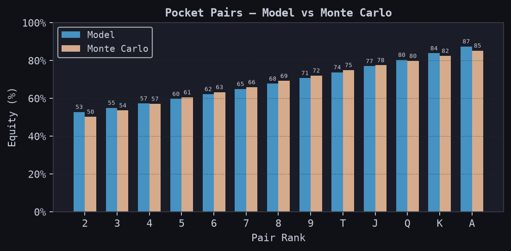

# Texas Hold'em Equity Calculator

A Python and C++ project that estimates preflop Texas Hold'em equity against one uniformly random opponent. A native Monte Carlo engine generates training labels, and a polynomial ridge regression model provides a compact approximation for comparison.

**[Results, graphs, and project analysis](analysis.md)**



## What the project does

- Simulates random opponent cards and five community cards in C++.
- Generates all 169 distinct starting-hand classes: 13 pocket pairs, 78 suited hands, and 78 offsuit hands.
- Trains a regression model using NumPy, scikit-learn feature engineering, and JAX linear algebra.
- Compares the saved model with a fresh simulation in a command-line calculator.
- Produces equity heatmaps, residual maps, pocket-pair comparisons, and feature-weight charts.

The predictor is a supervised machine learning model. It uses numerical hand features and ridge regression; the current implementation contains no large language model. See [future applications](analysis.md#skills-and-future-applications) for possible extensions.

## How it works

```text
poker_engine.cpp -> poker_engine.dll
                         |
                 generate_dataset.py
                         |
                 X_raw.npy + y_raw.npy
                         |
                  poker_analysis.py
                         |
       model_theta.npy + model_mu.npy + model_sigma.npy
                         |
             +-----------+-----------+
             |                       |
        poker_ui.py               plots.py
                                 |
                      report PNGs + results.json
```

Each hand is represented by `[high_card, low_card, is_suited, is_pair]`. Ranks run from `0` (two) to `12` (ace). Degree-two polynomial expansion produces 14 features; the model adds an intercept, standardizes the features, and solves ridge-regularized normal equations with `lambda = 0.001`.

Equity means `(wins + 0.5 * ties) / simulations`. It assumes a showdown against one random opponent, with no betting, folding, or opponent-range model.

## Requirements and supported platform

The native build currently targets **64-bit Windows** using MinGW-w64. Python loads the Windows DLL with `ctypes`. Linux and macOS require changes to the native export/build and shared-library loading.

Use one of the Python setup paths below. Run project commands from the repository's root folder: the scripts resolve the DLL and data paths relative to the terminal's working directory.

### Option A: MSYS2 MINGW64 Python

This is the appropriate path when `python` resolves to `C:\msys64\mingw64\bin\python.exe`.

Open **MSYS2 MINGW64** and update the installation:

```bash
pacman -Syu
```

If prompted to close the terminal, reopen MINGW64 and repeat the update. MSYS2 supports full system updates; completing this step avoids mixing newer packages with older runtime libraries. [MSYS2 update guidance](https://www.msys2.org/docs/updating/)

Install the compiler and Python packages for dataset generation, the calculator, and the graphs:

```bash
pacman -S --needed mingw-w64-x86_64-gcc mingw-w64-x86_64-python mingw-w64-x86_64-python-numpy mingw-w64-x86_64-python-scikit-learn mingw-w64-x86_64-python-matplotlib
```

Use MSYS2 packages for this interpreter. Its compiled Python extensions differ from standard Windows CPython wheels. [MSYS2 Python documentation](https://www.msys2.org/docs/python/)

The package names above are listed in the official [NumPy](https://packages.msys2.org/packages/mingw-w64-x86_64-python-numpy), [scikit-learn](https://packages.msys2.org/packages/mingw-w64-x86_64-python-scikit-learn), and [Matplotlib](https://packages.msys2.org/packages/mingw-w64-x86_64-python-matplotlib) package pages.

Verify the environment:

```bash
python -c "import sys, numpy, sklearn, matplotlib; print(sys.executable); print(numpy.__version__)"
g++ --version
```

Use the Colab training instructions below for JAX, then copy the exported model files back into the project. The saved model is already included for trying the calculator without retraining.

### Option B: Standard Windows CPython

Install 64-bit Python from [python.org](https://www.python.org/downloads/windows/), and install the MinGW-w64 compiler through MSYS2 as described above. Python 3.12 was used to verify the report and training workflow.

In PowerShell, from the project root, create a virtual environment using the standard CPython installation. These commands assume the Windows `py` launcher is available:

```powershell
py -3.12 -m venv .venv
.\.venv\Scripts\python.exe -m pip install -r requirements.txt
```

Select `.venv\Scripts\python.exe` with **Python: Select Interpreter** in VS Code. In the commands below, use `.\.venv\Scripts\python.exe` in place of `python`, or activate the environment first.

For local training on a supported JAX platform, install the optional training dependencies:

```powershell
.\.venv\Scripts\python.exe -m pip install -r requirements-training.txt
```

JAX's native Windows CPU support is experimental. A GPU is unnecessary for this small dataset; Colab is an alternative if the local JAX installation is unavailable. [JAX installation documentation](https://docs.jax.dev/en/latest/installation.html)

## Build and run

### 1. Build the C++ engine

From the project root in MINGW64:

```bash
g++ -std=c++17 -O3 -shared -o poker_engine.dll poker_engine.cpp -static -static-libgcc -static-libstdc++
```

The DLL is deliberately excluded from Git. Each user builds it from the checked-in source. Rebuild it after changing the C++ engine.

### 2. Generate the dataset

```bash
python generate_dataset.py
```

The generator runs 50,000 simulations for each of the 169 hand classes, totaling 8,450,000 simulated deals. It saves:

```text
X_raw.npy: (169, 4), float32
y_raw.npy: (169,), float32
```

The C++ engine seeds its random generator from the clock, so repeated runs produce slightly different labels. Runtime depends on the compiler and hardware.

**This command overwrites the saved dataset.** If you regenerate it, retrain the model and regenerate the figures to keep the artifacts consistent. The included `.npy` files are a small demonstration snapshot.

### 3. Train the model

For a standard CPython environment with the training dependencies installed:

```bash
python poker_analysis.py
```

The script performs five-fold cross-validation with shuffled splits and `random_state=42`. It fits scaling statistics only on each training fold, then fits a final model on all 169 rows and exports:

- `model_theta.npy`: 15 coefficients, including the intercept.
- `model_mu.npy`: 14 feature means.
- `model_sigma.npy`: 14 feature standard deviations, with a small stabilizing offset.

Training overwrites those three files.

For **Google Colab**, open a notebook at [colab.research.google.com](https://colab.research.google.com/). Upload `poker_analysis.py`, `X_raw.npy`, and `y_raw.npy`. Run:

```python
%pip install numpy scikit-learn jax
%run poker_analysis.py
```

Download the three exported model files into the project root. The training script has no Google-specific imports; it can also run locally with compatible dependencies.

### 4. Open the calculator

```bash
python poker_ui.py
```

Enter cards such as `As` and `Ks`. Ranks are `2` through `9`, `T`, `J`, `Q`, `K`, and `A`; suits are `c`, `d`, `h`, and `s`. Enter `q` at the first card prompt to quit.

For each valid hand, the UI prints the model estimate and a new 100,000-rollout Monte Carlo estimate. Its displayed model error is an absolute difference in **percentage points**. If model files are missing, the simulation still runs; scikit-learn remains an import dependency.

### 5. Generate the graphs and numeric results

```bash
python plots.py
```

This overwrites the four `plot_*.png` images and `results.json`. The JSON contains snapshot metrics, per-hand predictions, feature contributions, package versions, and SHA-256 hashes identifying the saved data/model files used in the figures.

The checked-in report is [analysis.md](analysis.md). Update its tables and interpretation after changing the model or dataset.

## Files

| File | Purpose |
| --- | --- |
| `poker_engine.cpp` | Seven-card hand evaluator and native Monte Carlo simulation |
| `generate_dataset.py` | Creates the 169-row dataset through `ctypes` |
| `poker_analysis.py` | Polynomial expansion, ridge regression, and cross-validation |
| `poker_ui.py` | Interactive model/simulation comparison |
| `plots.py` | Four report images and numeric snapshot results |
| `requirements.txt` | Verified standard CPython inference/report dependencies |
| `requirements-training.txt` | Optional JAX training dependencies |
| `X_raw.npy`, `y_raw.npy` | Saved feature/label snapshot |
| `model_*.npy` | Saved model and scaling parameters |
| `analysis.md`, `results.json`, `plot_*.png` | Human-readable analysis and supporting results |

## Publish this project to Barshan-B

These steps create a public repository under **`Barshan-B`**, including the hyphen.

1. Sign in to GitHub as `Barshan-B` and open [Create a new repository](https://github.com/new).
2. Set **Owner** to `Barshan-B`, name the repository **`poker-equity-calculator`**, and choose **Public**.
3. Suggested description: `Texas Hold'em equity estimation with a C++ Monte Carlo engine, Python, and polynomial ridge regression.`
4. Leave GitHub's initial README, `.gitignore`, and license options empty because this folder already supplies the first two. Choose a license separately if you want to grant reuse rights.
5. Click **Create repository**.

In your local project's PowerShell terminal, initialize Git if the folder is not already a repository:

```powershell
cd C:\Users\barsh\Downloads\PokerProject
git init -b main
```

Before the first commit, set the **local** author identity. Copy your verified email or GitHub-provided noreply address from [GitHub email settings](https://github.com/settings/emails); replace the placeholder below with that exact address:

```powershell
git config user.name "Barshan-B"
git config user.email "YOUR_GITHUB_VERIFIED_OR_NOREPLY_EMAIL"
git config credential.https://github.com.username Barshan-B
```

The author identity records who made the commit; push authentication is separate. When Git opens browser sign-in, use `Barshan-B`.

Review and commit the project:

```powershell
git add .
git status --short
git commit -m "Add poker equity calculator, graphs, and analysis"
```

The staged files should include source, documentation, dependencies, `.npy` files, `results.json`, and the four PNGs. `.gitignore` excludes the DLL, local environments, `.scratch`, editor settings, and the superseded `README (3).md`.

Connect and upload:

```powershell
git remote add origin https://github.com/Barshan-B/poker-equity-calculator.git
git remote -v
git push -u origin main
```

If your repository has another name, use its URL instead. If `origin` already exists, inspect `git remote -v` before changing it. Refresh the GitHub page and verify that the README, analysis images, and **Public** label appear under `Barshan-B`.

For later updates:

```powershell
git add .
git commit -m "Describe the update"
git push
```

These steps follow [GitHub's guide for importing local code](https://docs.github.com/en/migrations/importing-source-code/using-the-command-line-to-import-source-code/adding-locally-hosted-code-to-github?platform=windows).

## Troubleshooting

| Symptom | Next step |
| --- | --- |
| `No module named numpy` or `sklearn` | Run `python -c "import sys; print(sys.executable)"` and install packages for that exact interpreter. |
| MSYS2 runtime dependency conflicts | Complete `pacman -Syu`, reopening the terminal and repeating if requested, before installing individual packages. |
| `g++` is not found | Use the MINGW64 terminal with its compiler package installed. |
| DLL cannot be loaded | Build `poker_engine.dll`, use a 64-bit Python interpreter, and run from the project root. |
| JAX does not install under MSYS2 Python | Train in Colab or standard CPython, then copy the three exported model files back. |
| Missing `.npy` files | Generate the dataset and train the model, or restore the included snapshot. |
| GitHub denies a push | Check `git remote -v` and authenticate as `Barshan-B`, which must own or have write access to the repository. |

## Scope

This is a simulation and machine learning demonstration. It estimates preflop showdown equity against a random opponent. It does not model betting decisions, expected profit, multiple opponents, known community cards, or opponent-specific ranges. See [analysis.md](analysis.md) for evaluation limits and next steps.
