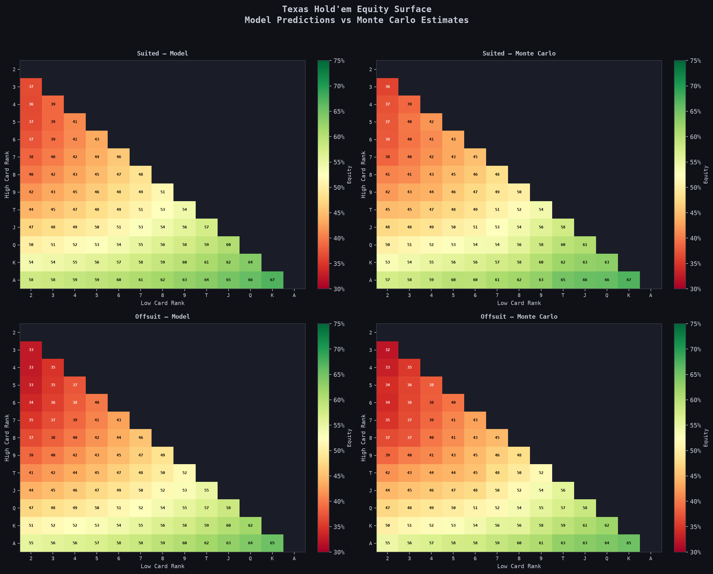
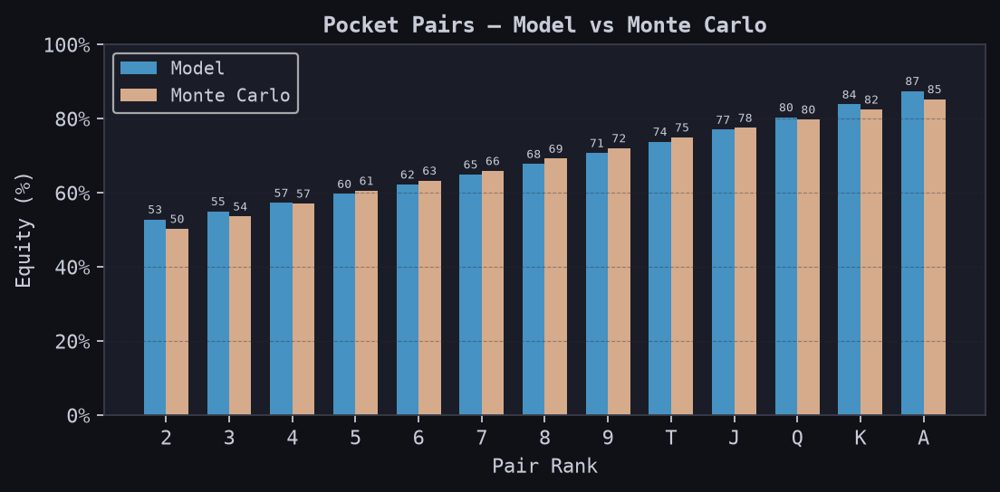
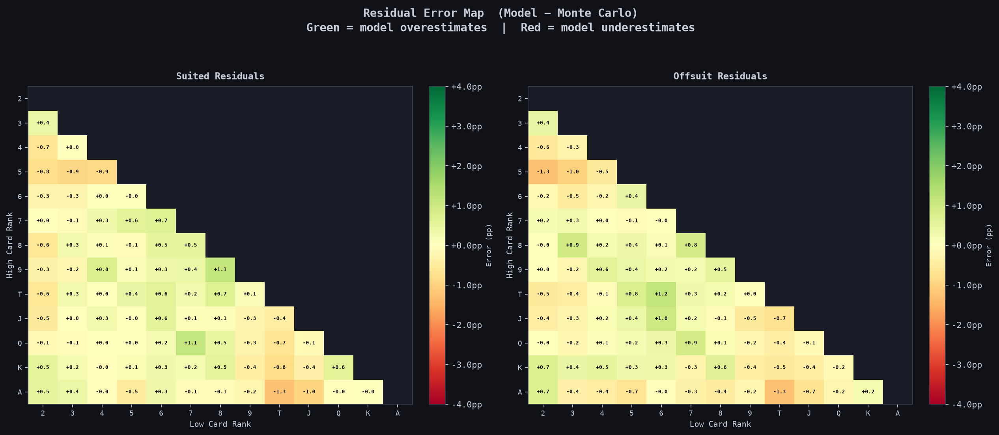
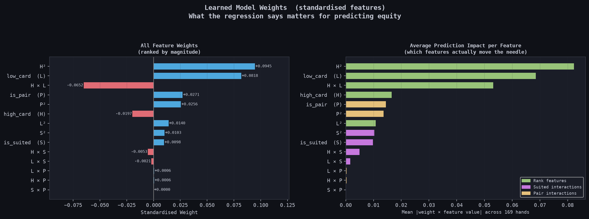

# Results and Analysis: Texas Hold'em Equity Estimation

Report snapshot: **November 9, 2026**. Results refer to the saved dataset and model included in this repository. Numeric values and the exact artifact hashes are recorded in [results.json](results.json). Setup and reproduction steps are in [README.md](README.md).

## Project objective

The project connects a C++ simulation engine to a Python data and modeling workflow. The engine estimates the preflop showdown equity of a starting hand against one uniformly random opponent. A small regression model then approximates that simulation output from four numerical features.

This demonstrates how simulation can supply labels when a direct analytical solution is inconvenient, and how a statistical approximation can provide a quick prediction for comparison with the simulator. The current implementation uses supervised machine learning through polynomial ridge regression. It contains no large language model or neural language-model training.

## Dataset and experiment

Texas Hold'em has 1,326 possible unordered two-card combinations. For this preflop experiment, suit symmetry reduces those combinations to 169 hand classes:

| Hand class | Rows | Example |
| --- | ---: | --- |
| Pocket pairs | 13 | `AA` |
| Suited non-pairs | 78 | `AKs` |
| Offsuit non-pairs | 78 | `AKo` |
| Total | 169 | |

The generator uses one representative holding for each class and 50,000 Monte Carlo rollouts per row, totaling **8,450,000 simulated deals**. It removes the hero's two cards, partially shuffles the remaining deck, samples two opponent cards and five shared community cards, and evaluates both seven-card holdings.

The target is `equity = (wins + 0.5 * ties) / rollouts`. The arrays have shapes `(169, 4)` and `(169,)`, both stored as `float32`. The four inputs are the high and low ranks, a suited flag, and a pair flag. Ranks are encoded from zero for a two to twelve for an ace.

The model expands these inputs into 14 degree-two polynomial features, standardizes them, adds an intercept, and solves ridge-regularized normal equations with `lambda = 0.001`. The intercept is excluded from the regularization penalty. Predictions are clipped to `[0, 1]`.

## Measured results

The table below compares the **existing saved model** against the **current saved simulation labels** across all 169 classes. These are snapshot agreement metrics. They are not an independent held-out test, and the saved files do not include the original model's training-run provenance.

| Metric | Measured value | Interpretation |
| --- | ---: | --- |
| Mean squared error | 0.0000353154 | Squared error in equity units |
| Mean absolute error | 0.4408 percentage points | Average absolute difference from the sampled labels |
| Root mean squared error | 0.5943 percentage points | Gives larger residuals more weight |
| Largest absolute error | 2.5490 percentage points | Occurs for pocket twos |
| R-squared | 0.99652 | Agreement with variation across the saved labels |
| Lowest simulated equity | 32.170% (`32o`) | Lowest label in this snapshot |
| Highest simulated equity | 85.239% (`AA`) | Highest label in this snapshot |

An error of 0.44 percentage points means, for example, a difference between 60.00% and 60.44%; it does not mean 44% error. R-squared is not classification accuracy or a guarantee that individual hands are predicted equally well.

The metrics weight each of the 169 classes equally. This differs from weighting all physical two-card combinations, because a pair has 6 combinations, a suited class 4, and an offsuit class 12.

### Separate cross-validation check

`poker_analysis.py` was also run on a copy of the saved dataset in a separate verification directory, preserving the published model files. The script completed five-fold shuffled cross-validation using `random_state=42`, fitting feature means and standard deviations only on each training fold. The test MSE values below are the script's printed values, rounded to five decimal places:

| Fold | Held-out MSE |
| --- | ---: |
| 1 | 0.00004 |
| 2 | 0.00003 |
| 3 | 0.00007 |
| 4 | 0.00004 |
| 5 | 0.00005 |
| Mean, as printed | 0.00005 +/- 0.00001 |

This check evaluates freshly fitted fold models, separately from the saved-model metrics above. It measures interpolation between hand classes within the same simulator and target definition. It does not establish performance for a different opponent range, a postflop board, or another poker variant. The model family and regularization were fixed in advance of this check; no hyperparameter search was performed here.

## Equity surfaces

Each valid cell is a non-pair starting-hand class. Rows indicate the higher rank and columns the lower rank. The diagonal and upper triangle are omitted; pocket pairs appear in a separate chart.

Higher ranks generally correspond to higher equity, and the model reproduces the broad progression in both suited and offsuit hands. In this snapshot, `AKs` has **67.217%** simulated equity, compared with **65.215%** for `AKo`. Across the 78 matched non-pair rank combinations, the mean suited advantage is **2.77 percentage points**, with equal weight given to each rank combination.

The smooth model surfaces approximate the large-scale structure. Local deviations remain because a degree-two polynomial has limited flexibility for effects such as connectedness and ace-low straight possibilities. The model has no explicit rank-gap or straight-connectivity feature.

## Pocket pairs

The simulation labels rise from **50.261%** for pocket twos to **85.239%** for pocket aces. The model follows the overall increase but has larger errors at the ends of this sequence.

| Hand | Monte Carlo equity | Saved-model equity | Model minus simulation |
| --- | ---: | ---: | ---: |
| `22` | 50.261% | 52.810% | +2.549 pp |
| `33` | 53.610% | 54.972% | +1.362 pp |
| `88` | 69.198% | 67.758% | -1.440 pp |
| `KK` | 82.465% | 83.838% | +1.373 pp |
| `AA` | 85.239% | 87.449% | +2.210 pp |

Pocket pairs account for only 13 of the 169 rows, so their larger residuals can be obscured by a strong aggregate score. Their mean absolute error is **1.1924 pp**, compared with **0.3621 pp** for suited non-pairs and **0.3943 pp** for offsuit non-pairs.

The pattern suggests that a shared quadratic surface does not capture the pair-specific curve completely. A small lookup table for pairs or a separate pair model would be useful comparisons before adding a more complex learner.

## Residual analysis

Residuals are `model equity - Monte Carlo equity`, expressed in percentage points. Positive values mean overestimation; negative values mean underestimation. These maps contain non-pairs; the largest errors overall are in the pair chart above.

The largest absolute non-pair discrepancies are approximately **1.27 pp** for both suited and offsuit groups. The maps reveal local patterns that an aggregate MSE cannot show, including underestimation for some ace-high combinations. These patterns can guide targeted feature engineering and higher-rollout simulation for the affected classes.

Some residual variation comes from the labels themselves. A Monte Carlo label is an estimate, rather than an exact enumerated probability. With independent bounded rollout outcomes in `[0, 1]`, the standard error of their mean is at most about **0.224 pp** at 50,000 rollouts. A normal approximation gives a worst-variance 95% sampling margin around **0.44 pp**. The actual uncertainty is hand-dependent, and this approximation does not validate the evaluator or account for model error. Several pair residuals are substantially larger than this scale, making model mismatch a plausible contributor.

## Feature weights and interpretation

The left panel ranks the 14 non-intercept coefficients by absolute magnitude. The right panel summarizes `mean(abs(weight * standardized_feature))` across the 169 classes. This is a description of contribution within the fitted model, rather than a causal measure of poker hand strength.

The three largest coefficients by magnitude are:

| Feature | Standardized coefficient |
| --- | ---: |
| High rank squared (`H²`) | +0.09453 |
| Low rank (`L`) | +0.08184 |
| High rank times low rank (`H × L`) | -0.06515 |

These same three features also have the largest average absolute contributions. Rank-related terms therefore account for much of the model's variation, while suitedness and the pair indicator adjust the estimate for hand structure.

Coefficient signs must be read jointly. A negative `H × L` term does not imply that two high cards are weak: all relevant linear, squared, and interaction terms contribute to the same prediction.

The feature design contains redundancy. For binary flags, `S² = S` and `P² = P`. A valid pair cannot also be suited, so `S × P` is always zero. On pair rows the high and low ranks are identical, making the two rank-by-pair interactions identical as well. Ridge regularization makes the linear solve possible despite such dependencies, but individual coefficients can share credit and shift numerically. Removing redundant columns and comparing validation error would make the feature story easier to interpret.

## Skills and future applications

| Skill demonstrated | Concrete work in this project | How it can be used going forward |
| --- | --- | --- |
| C++ programming | Array-based card representation, seven-card evaluation, partial shuffling, and repeated simulation | Physics or engineering simulations, native numerical libraries, and performance-sensitive processing |
| Python programming | Dataset orchestration, NumPy arrays, model inference, file handling, and a command-line interface | Data pipelines, automation, experiment tooling, and application prototypes |
| Python/C++ integration | `ctypes` signatures bridge Python inputs to an exported native function | Combine high-level workflows with optimized native components in scientific and engineering software |
| Monte Carlo methods | Approximate equity by averaging random simulated outcomes, including half-credit for ties | Reliability studies, uncertainty propagation, stochastic optimization, and simulated decision systems |
| Basic supervised machine learning | Learn a numeric target from engineered features using polynomial ridge regression | Build interpretable prediction baselines and approximation models for expensive computations |
| Numerical linear algebra | Standardization and regularized normal equations implemented with JAX | Understand conditioning, regularization, and solver behavior before moving to larger models |
| Validation and visualization | Cross-validation, subgroup errors, residual maps, and coefficient plots | Compare models systematically and identify where aggregate performance hides weaknesses |
| Reproducible software delivery | Source-controlled data/model snapshots, dependency files, artifact hashes, and documented build steps | Create projects others can inspect, rerun, review, and extend |

An LLM could be added later as a natural-language interface that parses a question and calls the existing numerical functions. For example, it could translate “compare ace-king suited with offsuit” into validated card inputs and explain the returned estimates. The simulation and regression would supply the numbers; the language model would handle interaction and explanation. That would require new code, input validation, and tests of tool use. No such integration is present in the current repository.

## Limitations and next steps

1. **Compare against a lookup baseline.** There are only 169 preflop classes, so looking up a stored label is simpler and exact with respect to that stored table. The regression is useful here as a learning and approximation exercise; its practical advantage should be demonstrated on a larger input space.
2. **Validate the native evaluator independently.** Add deterministic cases for wheels, flush ordering, two-trip full houses, three-pair kickers, and ties, then compare random valid hands against an independent evaluator. Successful dataset generation alone does not prove every ranking case correct.
3. **Make simulations reproducible.** Add an explicit RNG seed and store rollout counts, compiler options, source revision, and run metadata alongside each generated dataset. The current seed comes from the clock, and the saved files do not document their original build or training lineage.
4. **Guard the native API.** Validate distinct cards in `[0, 51]` and a positive iteration count at the exported C++ boundary. The current generator supplies valid inputs and the UI rejects duplicate cards, but the exported native function itself does not protect arbitrary callers.
5. **Improve the pair fit and feature design.** Compare separate pair models, rank-gap/connectivity features, and removal of redundant polynomial columns using the same validation protocol.
6. **Separate sampling error from model error.** Generate independently seeded, higher-rollout reference labels and report uncertainty. Reserve those references for evaluation rather than fitting.
7. **Measure performance directly.** Benchmark batched model inference, table lookup, and C++ simulation at equal workloads and hardware. This report makes no measured speedup claim.
8. **Expand the problem deliberately.** Known boards, multiple opponents, and weighted opponent ranges would require new simulator inputs, datasets, and evaluation. Preflop performance does not establish correctness for those settings.

## Reproduce the report

For the checked-in snapshot, install the inference/report dependencies and run `python plots.py` from the project root. This reads the saved `.npy` files, recreates the four PNGs, and writes [results.json](results.json). The report was verified with Python 3.12, NumPy 2.5.4, scikit-learn 1.9.1, and Matplotlib 3.11.2. The separate training check used JAX 0.12.0.1 on CPU.

To create a new experiment, follow the complete build, generation, training, and plotting sequence in [README.md](README.md). Regeneration changes the Monte Carlo labels, so record new metrics and revise this document before presenting a new snapshot.

The report preparation also verified the documented MinGW-w64 build command, ran the unmodified generator against the rebuilt DLL in an isolated directory, and exercised the calculator with `As`, `Ks`, then `q`. The generator returned the expected array shapes and the calculator displayed both model and simulation estimates before exiting normally. All four generated figures were visually inspected, and local Markdown links, recorded artifact hashes, and JSON metrics were checked. The repository's original dataset and model snapshot were preserved throughout these checks. These workflow checks do not replace independent validation of the native evaluator described above.
